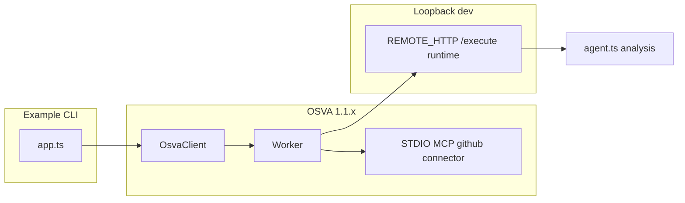

# 20 GitHub Repository Analyst

## What this demonstrates

**OSVA 1.1.x** agent that produces a **read-only repository intelligence brief** using the published GitHub MCP connector:

1. Accepts `owner`, `repo`, and bounded issue sampling parameters.
2. Registers **STDIO** MCP for `@osva-ai/connector-github@0.4.0`.
3. Discovers MCP tools and imports **only** `github.repository.get`, `github.issue.list`, and `github.issue.get`.
4. Binds imported `ToolVersion`s on an `AgentVersion` (no model binding; deterministic analysis).
5. Executes via **REMOTE_HTTP** (default loopback) or **TRUSTED_TYPESCRIPT**.
6. Polls the run and returns structured output plus **TOOL** run-step observability.

Write tools (`github.issue.create`, `github.issue.comment.create`) are never imported, bound, invoked, or tested.

```text
owner + repo + maxIssueSampleSize
        |
        v
Bootstrap: ConnectorVersion (STDIO) -> discover -> import 3 read tools
        |
        v
Agent run -> github.repository.get -> github.issue.list (bounded pages)
        |
        v
Deterministic brief: repository, issueSummary, themes, risks, recommendations, evidence
        |
        v
Run result + TOOL observability
```

## Architecture



## Compatibility (this example only)

| Component                   | Version |
| --------------------------- | ------- |
| OSVA OSS                    | `1.1.x` |
| `@osva-ai/sdk`              | `1.1.4` |
| `@osva-ai/contracts`        | `1.1.4` |
| `@osva-ai/connector-sdk`    | `1.1.4` |
| `@osva-ai/connector-github` | `0.4.0` |

Examples **01–18** remain on the legacy **1.0.0** track ([COMPATIBILITY.md](../../COMPATIBILITY.md)).

## Published GitHub MCP connector

| Transport    | Package support | This example                           |
| ------------ | --------------- | -------------------------------------- |
| **STDIO**    | Yes (only)      | Required for live MCP (worker-spawned) |
| **HTTP MCP** | No              | Not used (no fake HTTP bridge)         |

Imported MCP tools (read-only):

- `github.repository.get`
- `github.issue.list`
- `github.issue.get`

## Prerequisites

- Node.js 24+ and pnpm 12.4.1
- OSVA **1.1.x** web + worker for live runs
- API key with agent, run, connector, and tool permissions
- `@osva-ai/connector-github@0.4.0` installed on the **worker host** (or override STDIO command paths)
- Worker MCP **STDIO** opt-in (see OSVA operator docs)
- For loopback REMOTE_HTTP: `OSVA_REMOTE_HTTP_ALLOW_PRIVATE_NETWORKS=true` on the deployment

## Installation

From the repository root:

### PowerShell

```powershell
corepack enable
corepack prepare pnpm@12.4.1 --activate
pnpm install
pnpm --filter @osva-examples/20-github-repository-analyst build
```

### POSIX

```bash
corepack enable
corepack prepare pnpm@12.4.1 --activate
pnpm install
pnpm --filter @osva-examples/20-github-repository-analyst build
```

On the **worker host**, install the connector package globally or in a worker-readable path:

```bash
npm install @osva-ai/connector-github@0.4.0
```

## Worker STDIO and secrets

The published connector reads **`OSVA_CONNECTOR_GITHUB_TOKEN`** at process startup. Configure the token on the **worker** through supported OSVA secret resolution / worker environment injection—**never** embed tokens in `transportConfig` JSON.

Optional connector allowlist: **`OSVA_CONNECTOR_GITHUB_ALLOWED_REPOSITORIES`** (`owner/repo` comma-separated). When set, the connector rejects repositories outside the list before calling GitHub.

### Recommended fine-grained token permissions

| Tool usage                              | Repository access | GitHub permissions                      |
| --------------------------------------- | ----------------- | --------------------------------------- |
| `github.repository.get`                 | Target repos      | **Metadata** (read)                     |
| `github.issue.list`, `github.issue.get` | Same              | **Metadata** (read) + **Issues** (read) |

Do **not** grant **Issues** write. This example does not invoke write tools.

Override STDIO spawn (worker-reachable paths):

| Variable                             | Purpose                                           |
| ------------------------------------ | ------------------------------------------------- |
| `OSVA_MCP_CONNECTOR_STDIO_COMMAND`   | Executable (for example `node`)                   |
| `OSVA_MCP_CONNECTOR_STDIO_ARGS_JSON` | JSON array; default resolves published `stdio.js` |

## Configure

Copy `.env.example` and export variables in your shell (tests do not auto-load `.env`).

| Variable                        | Required     | Purpose                                     |
| ------------------------------- | ------------ | ------------------------------------------- |
| `OSVA_BASE_URL`                 | Live         | OSVA API base URL                           |
| `OSVA_API_KEY`                  | Live         | Bearer API key                              |
| `OSVA_AGENT_RUNTIME_URL`        | REMOTE_HTTP  | Worker-reachable `/execute` URL             |
| `OSVA_MCP_CONNECTOR_STDIO`      | Live         | Must be `true` (GitHub MCP is STDIO-only)   |
| `OSVA_EXAMPLE_REPO_OWNER`       | Optional     | Default `Osva-AI`                           |
| `OSVA_EXAMPLE_REPO_NAME`        | Optional     | Default `osva-examples`                     |
| `OSVA_EXAMPLE_MAX_ISSUE_SAMPLE` | Optional     | Default `20` (max **50**)                   |
| `OSVA_EXAMPLE_ISSUE_STATE`      | Optional     | `open`, `closed`, or `all` (default `open`) |
| `OSVA_EXAMPLE_ISSUE_PAGE_LIMIT` | Optional     | Default `1` (max **100** pages)             |
| `OSVA_TRUSTED_RUNTIME_ROOT`     | Trusted mode | Worker trusted runtime directory            |

## How to run

```bash
pnpm example:20
```

Expected JSON includes `toolActivity` (TOOL steps), `output.repository`, `output.issueSummary`, `output.themes`, `output.risks`, `output.recommendations`, and `output.evidence`. Sampling limitations appear in `output.issueSummary.sampling.limitation`.

## Deterministic offline fixture

Hermetic tests use repository `osva-examples-fixture/deterministic-github-brief` with `runKey` `evaluation-fixture` (no GitHub network). This does **not** prove live provider integration.

Run unit tests:

```bash
pnpm --filter @osva-examples/20-github-repository-analyst test
```

## Security boundaries

- Read-only MCP imports and read-scoped GitHub token are both required.
- Issue titles/bodies are **untrusted data**; analysis uses deterministic label/title heuristics only.
- No GitHub writes, including against test repositories.
- Tokens must not appear in run input, logs, artifacts, or git-tracked files.

## Troubleshooting

| Symptom                                            | Check                                                                        |
| -------------------------------------------------- | ---------------------------------------------------------------------------- |
| `GitHub MCP requires worker STDIO`                 | Set `OSVA_MCP_CONNECTOR_STDIO=true`                                          |
| MCP discovery missing tools                        | Install `@osva-ai/connector-github@0.4.0` on worker; verify STDIO command    |
| `CONFIGURATION_ERROR` from connector               | Worker has `OSVA_CONNECTOR_GITHUB_TOKEN`                                     |
| `Repository is not in the allowed repository list` | Adjust `OSVA_CONNECTOR_GITHUB_ALLOWED_REPOSITORIES` or run input owner/repo  |
| Empty `output`                                     | Inspect run attempt error and `toolActivity` in worker logs (redact secrets) |

## Cleanup

Live runs create connector registrations, tool versions, agents, and runs in your OSVA workspace. Delete or archive them through OSVA Console or API when finished.

## Verification status

| Check                        | Status                        |
| ---------------------------- | ----------------------------- |
| Hermetic vitest (Example 20) | Offline CI                    |
| `pnpm acceptance:b6-2-pins`  | Published pin verification    |
| `pnpm verify:compatibility`  | Matrix includes Example 20    |
| Live OSVA + GitHub           | Manual operator step (not CI) |

## B6.2 external consumer

`pnpm acceptance:b6-2-pins` validates that Example 20 depends only on the documented published `@osva-ai/*` versions (no `workspace:*` connector links in that check). Full npm-only materialization for Example 20 is planned for **B6.2B** (M19.2-style harness extension).
